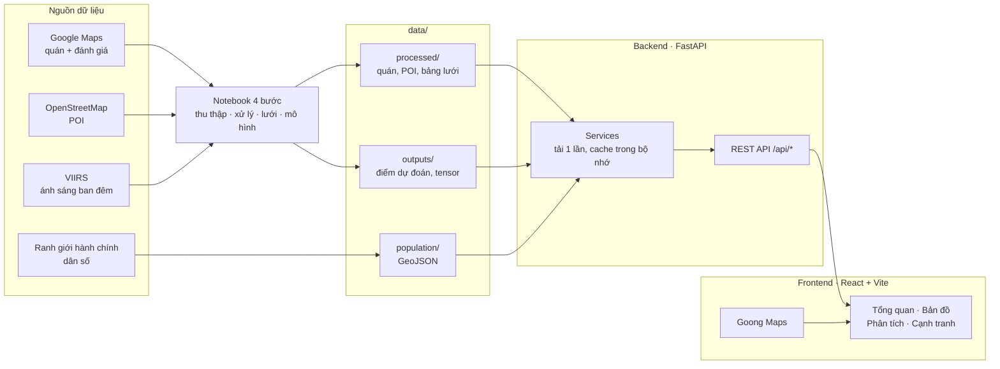
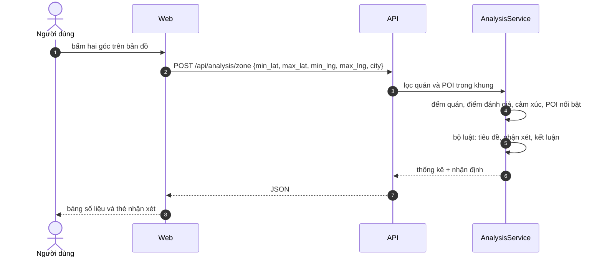

<div align="center">

# 🏙️ SmartSite

**Nền tảng phân tích không gian địa lý hỗ trợ chọn địa điểm kinh doanh F&B, chấm điểm tiềm năng từng ô lưới đô thị bằng mô hình học sâu đa phương thức**


[](LICENSE)

[Giới thiệu](#giới-thiệu) ·
[Demo](#demo) ·
[Kiến trúc](#kiến-trúc) ·
[Dữ liệu và mô hình](#dữ-liệu-và-mô-hình) ·
[Bắt đầu nhanh](#bắt-đầu-nhanh) ·
[API](#api)

</div>

---

## Giới thiệu

Mở một quán cà phê là một khoản đầu tư lớn, nhưng việc chọn mặt bằng thường dựa vào cảm tính: thấy đông người qua lại,
nghe người quen giới thiệu, hoặc đi khảo sát vài buổi. Câu hỏi thật sự khó hơn nhiều: khu này đã có bao nhiêu quán,
khách đánh giá họ thế nào, xung quanh có trường học, văn phòng hay khu dân cư không, và ban đêm khu vực có còn hoạt động?

SmartSite trả lời những câu hỏi đó bằng dữ liệu. Hệ thống chia thành phố thành các ô lưới khoảng 500 m, gom dữ liệu từ
nhiều nguồn vào từng ô, rồi dùng mô hình học sâu để chấm điểm tiềm năng:

- **Google Maps:** quán cà phê, trà; điểm đánh giá, số lượt đánh giá và cảm xúc trong nội dung đánh giá.
- **OpenStreetMap:** điểm quan tâm (POI) chia thành 7 nhóm: ẩm thực, thương mại, giải trí, giao thông, văn phòng, giáo
  dục, dân cư.
- **Ảnh vệ tinh ánh sáng ban đêm (VIIRS):** đại diện cho mức độ hoạt động kinh tế sau giờ làm việc.
- **Ranh giới hành chính và dân số:** mật độ dân số theo quận.

**Thành phố hỗ trợ:** Đà Nẵng, TP. Hồ Chí Minh, Hà Nội.

### Ai dùng và dùng để làm gì

| Người dùng | Dùng SmartSite để |
| --- | --- |
| Người sắp mở quán | Tìm khu có tiềm năng cao mà còn ít đối thủ, kiểm tra nhanh một khu vực cụ thể |
| Chuỗi F&B | So sánh quận, thành phố để lên kế hoạch mở rộng |
| Nhà đầu tư, môi giới mặt bằng | Đánh giá giá trị thương mại của một khu vực bằng số liệu |
| Nhà quy hoạch đô thị | Xem phân bố dịch vụ, mật độ dân số và các khoảng trống thị trường |

### Tính năng nổi bật

**Tổng quan điều hành** (`/overview`)
- KPI: tổng số quán đã thu thập, số điểm nóng hạng A+, độ sáng ban đêm trung bình, tổng lượt đánh giá.
- Cơ cấu hệ sinh thái POI, phân bố cảm xúc khách hàng, xếp hạng quận.
- So sánh Đà Nẵng, TP. Hồ Chí Minh và Hà Nội; liên kết giữa các vùng.
- Khoảng trống thị trường: những ô chưa có quán nhưng có điểm tiềm năng cao.
- Thẻ gợi ý chiến lược theo số liệu của thành phố.

**Bản đồ thị trường** (`/map`)
- Lưới ô màu theo điểm tiềm năng, từ Rất thấp đến Rất cao.
- Bật/tắt lớp POI (màu theo nhóm) và lớp bản đồ nhiệt mật độ dân số (chuẩn hóa theo bách phân vị 95).
- Bấm vào một ô để xem chi tiết: điểm, số quán, tổng lượt đánh giá, độ sáng ban đêm, mật độ POI.

**Phân tích địa điểm** (`/analysis`)
- Vẽ vùng chọn trên bản đồ bằng cách bấm hai góc.
- Thống kê trong vùng: số quán, điểm đánh giá, cảm xúc khách hàng, phân bố POI.
- Bộ luật tự sinh tiêu đề, các nhận xét và kết luận nên hay không nên mở quán ở khu vực đó.

**Bức tranh cạnh tranh** (`/competition`)
- Tổng số ô, tổng số quán, tỷ lệ ô đã có quán, số quán nhiều nhất trong một ô.
- Biểu đồ phân bố hạng tiềm năng, mật độ quán mỗi ô và điểm tiềm năng.
- Bảng xếp hạng quận: số quán, tỷ lệ phủ, điểm trung bình, số điểm nóng.

## Demo

<div align="center">
  
</div>

## Kiến trúc



### Phân tích một vùng chọn



### Các quyết định thiết kế

| Quyết định | Lý do |
| --- | --- |
| Phân tích theo ô lưới thay vì theo từng điểm | Mỗi ô có cùng diện tích nên so sánh mật độ công bằng trên toàn thành phố |
| Tải dữ liệu một lần rồi giữ trong bộ nhớ | Dữ liệu chỉ đọc, không ghi, nên tránh đọc file lặp lại ở mỗi request |
| Sinh đa giác ô lưới ở server | Chỉ lưu tọa độ tâm trong CSV, đa giác dựng từ tâm với nửa cạnh 0,0025° khi cần |
| Cắt lưới theo ranh giới đất liền | Spatial join với GeoJSON hành chính để bỏ các ô nằm trên biển, sông |
| Có dữ liệu giả khi thiếu file | Không có file đã xử lý thì service dùng dữ liệu giả, giao diện vẫn chạy được để thử |
| Goong Maps | Bản đồ tiếng Việt, tương thích API Mapbox GL nên dùng được các lớp source/layer quen thuộc |

## Dữ liệu và mô hình

### Pipeline notebook

| Bước | Thư mục | Việc |
| --- | --- | --- |
| 1. Thu thập | `notebooks/step1_extract/` | Crawl quán và đánh giá trên Google Maps cho 3 thành phố, lấy POI từ OSM, tải ảnh VIIRS |
| 2. Xử lý | `notebooks/step2_processing/` | Làm sạch, bỏ trùng, chấm điểm cảm xúc của đánh giá |
| 3. Không gian | `notebooks/step3_spatial/` | Dựng lưới, spatial join, tính đặc trưng mỗi ô (số quán, độ sáng ban đêm, mật độ POI) |
| 4. Mô hình | `notebooks/step4_model/` | Huấn luyện mô hình, xuất `Grid_Predictions.csv` gồm điểm và hạng tiềm năng |

### Nhãn tiềm năng

Giá trị thô của mỗi ô kết hợp quy mô thị trường, chất lượng đánh giá và mức sôi động của khu vực lân cận:

$$V_{raw} = \ln(1 + N_{cafe}) \times \ln(1 + N_{review}) \times \frac{\frac{R_{bayes}}{5} + S_{nlp}}{2} \times E_{neighbor}$$

$$E_{neighbor} = 0.5 + \frac{NTL_{neighbor}}{NTL_{neighbor,max}}$$

Trong đó $R_{bayes}$ là điểm đánh giá đã hiệu chỉnh Bayes, $S_{nlp}$ là điểm cảm xúc của nội dung đánh giá và
$NTL_{neighbor}$ là độ sáng ban đêm của các ô xung quanh. Mỗi ô được gán một trong 3 nhãn:

| Ô | Điều kiện | Nhãn |
| --- | --- | --- |
| Đã có quán | $V_{raw}$ lớn hơn trung vị | Tiềm năng cao (đã được thị trường chứng minh) |
| Đã có quán | $V_{raw}$ không quá trung vị | Tiềm năng trung bình |
| Chưa có quán | Độ sáng ban đêm xung quanh thuộc nhóm 15% cao nhất trong các ô trống | Tiềm năng trung bình |
| Chưa có quán | Còn lại | Không tiềm năng |

### Mô hình

Mô hình đa phương thức gồm ba phần:

- **Embedding** cho biến phân loại (thành phố).
- **Cross Network** học tương tác giữa các đặc trưng dạng bảng của ô.
- **Deep Network** cho các đặc trưng dạng bảng, kết hợp một nhánh **CNN** đọc tensor không gian 11 × 11 × 11 kênh của
  vùng lân cận quanh mỗi ô.

Các nhánh được ghép lại, đầu ra softmax cho 3 nhãn. Lớp "Không tiềm năng" được lấy mẫu giảm khi huấn luyện để cân bằng
dữ liệu. Mô hình được so sánh với các mô hình truyền thống (ví dụ hồi quy logistic) bằng accuracy và F1 trên tập kiểm
tra.

### Bộ dữ liệu

| File | Nội dung | Kích thước |
| --- | --- | --- |
| `data/processed/Coffee_Tea_Data_GGMap.csv` | Quán cà phê, trà: thông tin, đánh giá, điểm cảm xúc | ~877 KB |
| `data/processed/Coffee_Tea_Data_POI.geojson` | POI OSM đã phân nhóm cho 3 thành phố | ~13 MB |
| `data/processed/Spatial_Grid_Tabular.csv` | Đặc trưng dạng bảng của từng ô | ~8 MB |
| `data/outputs/Grid_Predictions.csv` | Điểm và hạng tiềm năng từ mô hình | ~8.5 MB |
| `data/outputs/Spatial_Tensors.npz` | Tensor không gian nhiều kênh, đầu vào nhánh CNN | ~38 MB |
| `data/population/*.geojson` | Ranh giới và dân số Đà Nẵng, TP. HCM, Hà Nội | có trong repo |

Các thư mục `data/raw/`, `data/processed/`, `data/outputs/` và `models/` không được đưa lên git. Chạy lại notebook để
tạo, hoặc chép từ nguồn lưu trữ của nhóm.

## Bắt đầu nhanh

### Yêu cầu

- Python 3.9+
- Node.js 18+
- API key Goong Maps ([đăng ký miễn phí](https://account.goong.io))

### Backend

```bash
git clone https://github.com/ductrien261/smart-site.git
cd smart-site/backend
python -m venv venv
venv\Scripts\activate            # Windows
# source venv/bin/activate       # macOS / Linux
pip install -r requirements.txt
uvicorn main:app --reload --port 8000
```

API chạy tại http://localhost:8000, tài liệu Swagger tại http://localhost:8000/docs. Thiếu file dữ liệu đã xử lý thì
backend tự dùng dữ liệu giả.

`requirements.txt` có cả TensorFlow và scikit-learn để chạy notebook. Nếu chỉ chạy web, có thể bỏ hai thư viện này
cho cài nhanh hơn.

### Frontend

Mở terminal khác:

```bash
cd frontend
npm install
echo VITE_GOONG_MAPTILES_KEY=key_cua_ban > .env
npm run dev                      # http://localhost:5173
```

Vite tự chuyển mọi request `/api/*` sang `http://localhost:8000`, nên lúc phát triển không cần cấu hình CORS.

## Cấu hình

| Biến | Vị trí | Ý nghĩa |
| --- | --- | --- |
| `VITE_GOONG_MAPTILES_KEY` | `frontend/.env` | Key tile của Goong Maps. Thiếu key thì bản đồ hiện hướng dẫn cấu hình thay vì bản đồ |

## API

Base URL: `http://localhost:8000/api`. Hầu hết endpoint nhận tham số `city`: `DaNang`, `HCM`, `HaNoi` (một số endpoint thống kê nhận thêm `all`).

| Nhóm | Phương thức | Endpoint | Việc |
| --- | --- | --- | --- |
| Thống kê | `GET` | `/stats/macro` | KPI vĩ mô: tổng quán, điểm nóng, độ sáng ban đêm, lượt đánh giá |
| | `GET` | `/stats/city-compare` | So sánh 3 thành phố |
| | `GET` | `/stats/market-gap` | Số ô chưa có quán nhưng tiềm năng cao |
| | `GET` | `/stats/sentiment` | Phân bố cảm xúc khách hàng |
| | `GET` | `/stats/district-ranking` | Xếp hạng quận theo điểm |
| | `GET` | `/stats/poi-ecosystem` | Cơ cấu POI theo nhóm |
| | `GET` | `/stats/region-linkage` | Liên kết giữa các vùng |
| | `GET` | `/stats/strategy-stats` | Số liệu cho thẻ gợi ý chiến lược |
| Lưới | `GET` | `/grid` | Danh sách ô có lọc và phân trang (`district`, `min_cafes`, `max_cafes`, `sort_by`, `page`, `page_size`) |
| | `GET` | `/grid/geojson` | GeoJSON đa giác lưới để vẽ bản đồ |
| | `GET` | `/grid/districts` | Danh sách quận của thành phố |
| POI | `GET` | `/poi` | GeoJSON POI của thành phố |
| Dân số | `GET` | `/population` | GeoJSON ranh giới và mật độ dân số |
| Phân tích | `POST` | `/analysis/zone` | Phân tích một khung chọn. Body: `{ min_lat, max_lat, min_lng, max_lng, city }` |
| Cạnh tranh | `GET` | `/competition/overview` | Toàn bộ số liệu cạnh tranh của thành phố |

## Công nghệ

| Phần | Công nghệ |
| --- | --- |
| Thu thập, xử lý | Python, pandas, GeoPandas, NumPy, Jupyter |
| Mô hình | TensorFlow / Keras, scikit-learn |
| Backend | FastAPI, Uvicorn |
| Giao diện | React 19, TypeScript, Vite, Tailwind CSS 4, React Router 7, Recharts, Axios |
| Bản đồ | Goong Maps (tương thích Mapbox GL) |

## Cấu trúc thư mục

```text
smart-site/
├── backend/
│   ├── main.py                  # khởi tạo app, CORS, gắn router
│   ├── config.py                # đường dẫn dữ liệu
│   ├── api/routes/              # stats, grid, poi, population, analysis, competition
│   └── services/                # nghiệp vụ, tải và cache dữ liệu, dữ liệu giả
├── frontend/
│   ├── src/
│   │   ├── pages/               # Overview, Map, Analysis, Competition
│   │   ├── components/
│   │   │   ├── GoongMap/        # vòng đời bản đồ, helper source/layer
│   │   │   ├── map/             # GridLayer, PoiLayer, PopulationLayer, GridDetailPanel
│   │   │   ├── analysis/        # bảng thống kê và nhận xét vùng chọn
│   │   │   ├── overview/        # KPI, so sánh thành phố, khoảng trống thị trường, chiến lược
│   │   │   └── layout/          # thanh điều hướng
│   │   ├── hooks/useAnalysis.ts
│   │   ├── services/api.ts      # Axios client
│   │   └── types/
│   └── vite.config.ts           # proxy /api sang :8000
├── notebooks/                   # 4 bước: extract, processing, spatial, model
├── data/population/             # GeoJSON ranh giới hành chính
└── demo.gif
```

## Giấy phép

[GNU GPL v3.0](LICENSE). Dữ liệu quán và đánh giá thuộc Google Maps, dữ liệu POI thuộc © OpenStreetMap contributors (ODbL),
ảnh ánh sáng ban đêm từ NASA/NOAA VIIRS.
